<div align="center">
  
  <h1>Audenic</h1>
  <p><strong>A native-grade music and video studio that runs one TypeScript codebase on Android, Windows, Linux and the web.</strong></p>
  <p>
    React 19 · TypeScript · Vite 7 · Web Audio DSP · Capacitor 6 (Android, API 36) · Tauri 2 (desktop)
  </p>
</div>

---

Audenic is a personal media workstation: a player, an equaliser suite, a harmonic DJ automix
station, a video/reels surface and a 30 000-station radio browser — all driven by one React
front end. What makes it unusual is the **dual audio back end**: the same effect graph is
rendered by Web Audio on web/desktop and re-created inside Android's own audio stack
(`android.media.audiofx` attached to ExoPlayer) on Android, so playback survives the lock
screen, notification controls and battery savers instead of being throttled by a WebView.

<div align="center">
  
</div>

---

## Feature map

| Area | What it does |
| :--- | :--- |
| **Playback** | Queue, shuffle, repeat, gapless seek, sleep-friendly background audio, likes, progress restore |
| **Equalizer suite** | 5-band parametric EQ, bass boost, reverb, loudness normalisation, live spectrum analyser |
| **DJ mixer** | Resonant filter sweep, low/mid/high EQ kills, convolution reverb, stereo delay, tube saturation, automix transitions |
| **Harmonic analysis** | Tempo estimation from onset energy flux, key detection via chromagram + Krumhansl–Schmuckler correlation, Camelot-wheel compatible |
| **Library** | Local media scan, tag reading, folder hierarchy, playlists, artwork cache, Cloudflare R2 upload |
| **Video** | 1080p course player with picture-in-picture, vertical snap-scroll reels, audio-only MP3 extraction mode |
| **Radio** | 30 000+ live stations through Radio-Browser mirrors |
| **Lyrics + AI** | `.lrc` synced lyrics, Gemini / Groq / Ollama-backed assistant, ElevenLabs voice |
| **Accounts** | Firebase auth, Google Drive mode, achievements, analytics, admin and diagnostics surfaces |
| **Android extras** | Foreground media service, notification + lock-screen actions, headset/Bluetooth media buttons, overlay and "island" controls |

---

## Audio pipeline

<div align="center">
  
</div>

Two implementations, one interface:

| Stage | Web / desktop (`src/player/audioEngine.ts`, `audioEffects.ts`) | Android native (`AudenicPlaybackService.java`) |
| :--- | :--- | :--- |
| Source | `AudioContext` graph over `<audio>` | ExoPlayer (`media3` 1.3.1) |
| EQ | 5 peaking/shelf `BiquadFilterNode`s | `android.media.audiofx.Equalizer` |
| Bass | Low-shelf node | `android.media.audiofx.BassBoost` |
| Reverb | Convolver with generated impulse responses (hall, room, plate, cathedral) | `android.media.audiofx.PresetReverb`, routed as an aux send via `Player.setAuxEffectInfo(AuxEffectInfo)` |
| Master | Gain + loudness normalise + output gate | Player volume |
| Visualiser | `AnalyserNode` | — |

On Android the Web Audio graph is deliberately muted (`engine.muteOutput(isNative())`) because
ExoPlayer owns the audio stream — the bridge in [`src/player/nativeBridge.ts`](src/player/nativeBridge.ts)
mirrors every effect call into the native player instead. Effects without an `audiofx`
counterpart (delay, filter sweep, EQ kills) therefore stay silent on Android; see
[Known limitations](#known-limitations).

## Native bridge surface

`AudenicMedia` (Capacitor plugin, 12 methods) — live source:
[android/app/src/main/java/fm/audenic/app/AudenicMediaPlugin.java](android/app/src/main/java/fm/audenic/app/AudenicMediaPlugin.java),
service: [AudenicPlaybackService.java](android/app/src/main/java/fm/audenic/app/AudenicPlaybackService.java)

| Group | Methods |
| :--- | :--- |
| Library | `scan` · `delete` |
| Transport | `playback` · `loadQueue` · `updatePosition` |
| Effects | `setEqualizer` · `setReverb` |
| System UI | `updateNotification` · `hasOverlayPermission` · `requestOverlayPermission` · `toggleIsland` |
| Downloads | `download` |

---

## Supported platforms

| Platform | Shell | Status |
| :--- | :--- | :--- |
| Android (min SDK 26, target SDK 36) | Capacitor 6 + Java | Primary target |
| Windows | Tauri 2 | Supported, CI-built |
| Linux | Tauri 2 | Supported, CI-built (AppImage, deb) |
| Web / PWA | Vite build | Supported |
| iOS | — | Not configured |
| Flutter rewrite (`audenic_flutter/`) | — | Abandoned, kept for reference only |

---

## Keyboard shortcuts (desktop)

| Shortcut | Action |
| :--- | :--- |
| `Space` | Play / pause |
| `→` / `←` | Seek ±5 s |
| `↑` / `↓` | Master volume ±5 % |
| `M` | Mute |
| `F` | Fullscreen |
| `\` or `Ctrl+B` | Toggle sidebar |
| `Esc` | Close overlay / simple mode |

---

## Getting started

### Prerequisites

- **Node.js** 18 or newer
- **Android Studio** with an SDK platform matching API 36 — for the Android app
- **Rust** ([rustup.rs](https://rustup.rs)) — only for Tauri desktop builds
- **Windows**: Visual Studio C++ Build Tools with the Windows 10/11 SDK

### Install

```bash
git clone https://github.com/mwijay12/audenic-music.git
cd audenic-music
npm install
cp .env.example .env   # optional: only needed for AI, TTS and R2 features
```

### Run the web app

```bash
npm run dev          # Vite dev server
npm run build        # production bundle into dist/
```

### Run on Android

```bash
npm run build            # required: dist/ is git-ignored, the shell loads it at runtime
npx cap sync android
npx cap open android     # then Build > Run in Android Studio
```

The full Android walkthrough — permissions, WebView tuning, notification icon, signed
release APK/AAB, gesture and feature-permission maps — lives in
[ANDROID_SETUP.md](ANDROID_SETUP.md).

> **Before you build:** `android/variables.gradle` targets API 36, which the pinned Android
> Gradle Plugin in `android/build.gradle` may reject. If Gradle reports an unsupported
> `compileSdkVersion`, raise AGP (and the matching Gradle wrapper) instead of dropping the SDK level.

### Run on desktop

```bash
npm run tauri:dev     # hot-reloading window
npm run tauri:build   # installers
```

Linux build prerequisites:

```bash
sudo apt-get update
sudo apt-get install -y libwebkit2gtk-4.1-dev libgtk-3-dev libappindicator3-dev librsvg2-dev patchelf xdg-utils
```

Desktop outputs land in `src-tauri/target/release/`:

- `bundle/nsis/Audenic_2.0.0_x64-setup.exe` — Windows installer (file associations for MP3/FLAC/WAV/MP4)
- `bundle/appimage/Audenic_2.0.0_amd64.AppImage` — portable Linux
- `bundle/deb/audenic_2.0.0_amd64.deb` — system-wide Linux package

### CI

[`.github/workflows/build.yml`](.github/workflows/build.yml) builds Linux and Windows
artifacts on every push to `main` and on `v*` tags, then attaches them to the release.

---

## Configuration

Credentials stay out of the source tree; `.env` is git-ignored and `.env.example` documents
every key.

| Variable | Purpose |
| :--- | :--- |
| `VITE_GEMINI_KEYS` | Comma-separated keys for the assistant and lyric processing |
| `VITE_GROQ_KEYS` | Fast inference fallback |
| `VITE_ELEVENLABS_TTS_KEYS` | Text-to-speech voice synthesis |
| `VITE_R2_*` | Cloudflare R2 bucket credentials for audio distribution |

---

## Repository layout

```
audenic-music/
├── src/
│   ├── player/        audio engine, effects rack, DJ + automix engine, native + Tauri bridges
│   ├── screens/       25 product surfaces (Home, Now Playing, Equalizer, DJ Mixer, Reels, …)
│   ├── components/    shared UI
│   ├── auth/ hooks/ lib/ utils/ data/ onboarding/
├── android/           Capacitor Android shell (Java) + audiofx pipeline — the live code
├── src-tauri/         Tauri 2 desktop shell
├── assets/            animated SVG diagrams used by this README
├── HANDOVER.md        current build state, blockers and open work
└── .github/workflows/ multi-platform release CI
```

---

## Known limitations

Tracked in detail in [HANDOVER.md](HANDOVER.md):

- **Android Gradle Plugin vs API 36** — the pinned AGP may refuse `compileSdkVersion 36`; bump AGP + Gradle wrapper.
- **Effects with no `audiofx` equivalent** — delay, DJ filter sweep and the three EQ kills are Web-Audio only, so they are silent on Android.
- **Flanger** — exposed in the effects state but not implemented on any platform yet.
- **Native reverb fidelity** — `PresetReverb` offers four coarse presets against the four generated convolution impulses used on web.
- **`targetSdk 36` behaviour changes** — edge-to-edge enforcement makes the status/nav-bar colour calls in `MainActivity` no-ops, and `usesCleartextTraffic="true"` is on Android 17's deprecation path; both need a pass on real devices.
- **Android 17 background-audio hardening** — playback is compliant today (explicit `mediaPlayback` foreground-service type, media3 audio focus, wake lock, `POST_NOTIFICATIONS` requested on the play path), but it has never been exercised against `adb shell cmd audio set-enable-hardening enable`. That check, and the targetSdk-37 while-in-use requirement, are still outstanding — see HANDOVER.md.
- **~~Duplicate native plugins~~ (resolved)** — the dead `AudenicPlayback`/`PlaybackPlugin.java` plugin has been retired: removed from `MainActivity.java`'s `registerPlugin()` calls, deleted, and its last caller (`nativeBridge.ts`'s `loadQueueNative`) now talks to the live `AudenicMedia` plugin directly. `AudenicMedia` is the only native playback plugin.
- **~~Duplicated native sources~~ (resolved)** — the drifted `native/android/` bootstrap template (stale copies of the plugin + service, hundreds of lines behind the live files and quoting media3 `1.4.1` against the real `1.3.1`) has been removed. If you ever re-run `npx cap add android`, copy directly from `android/app/src/main/java/fm/audenic/app/` — there is no bootstrap template to paste from anymore.
- **On-device verification** — the latest playback, wakelock and reverb work is code-complete and type-checks clean, but has not yet been exercised on physical Android hardware.

---

## Contributing

Fork the repository, branch from `main`, and keep changes inside `src/` unless you are
deliberately touching the Android or Tauri shells. Run `npm run build` before
`npx cap sync android` so the native shell picks up the new bundle.

## License

Copyright © 2026 **Altraware Technologies** (David Erick Mwijage). All rights reserved.
This source code is proprietary to Altraware Technologies and may not be copied, modified,
distributed, sold, or otherwise used without explicit written permission. Full terms in
[LICENSE](LICENSE); licensing inquiries via [github.com/mwijay12](https://github.com/mwijay12).

<div align="center">
  <sub>Built with React 19 · TypeScript · Vite 7 · Capacitor 6 · Tauri 2 · ExoPlayer · Web Audio API</sub>
</div>
